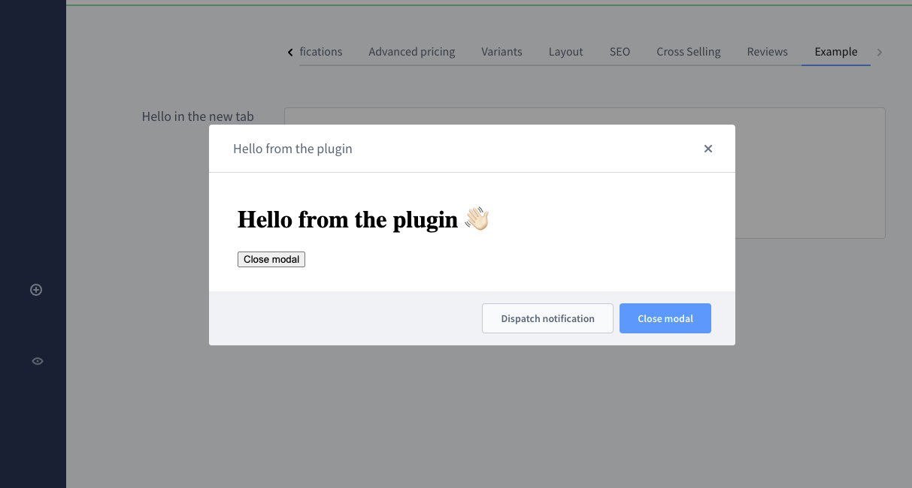

# Modals

Modals display dialog windows in front of the Shopware Administration interface.

They should be triggered by user interaction and used for confirmations, forms, or multi-step workflows. To return to the main content the user must engage with the modal by completing an action or by closing it.

Avoid opening modals automatically without context, as this interrupts the user’s workflow. For example, it is poor practice to show modals immediately after login (such as changelogs) that users must manually dismiss.

See also: [Base Options](../base-options.md) for shared configuration options supported by SDK message APIs.

```ts
import { notification, ui } from "@shopware-ag/meteor-admin-sdk";
```

## modal.open()

Open a new modal in the current view. The content of the modal is determined by your `locationId` or by using plain text with `textContent`.

#### Usage

```ts
ui.modal.open({
  title: "Your modal title",
  // Use locationId for rendering custom content inside modal
  locationId: "your-location-id",
  // Use textContent when no locationId is needed
  textContent: "Do you really want to dispatch a notification?",
  variant: "large",
  showHeader: true,
  showFooter: false,
  closable: true,
  buttons: [
    {
      label: "Dispatch notification",
      method: () => {
        notification.dispatch({
          message: "Hello from the modal",
          title: "Modal example",
        });
      },
    },
    {
      label: "Close modal",
      variant: "primary",
      method: () => {
        ui.modal.close({
          locationId: "your-location-id",
        });
      },
    },
  ],
});
```

#### Parameters

| Name          | Required | Default   | Description                                                                                    | Available at Shopware |
| :------------ | :------- | :-------- | :--------------------------------------------------------------------------------------------- | :-------------------- |
| `title`       | true     |           | The title of the modal                                                                         |                       |
| `locationId`  | false    |           | The id for the content of the modal. If not provided it will render the `textContent`          |                       |
| `textContent` | false    |           | The plain text content of the modal. Will only be rendered if no `locationId` is given         | v.6.7.1               |
| `variant`     | false    | 'default' | Determine the size of the modal. Possible values are 'default', 'small', 'large' and 'full'    |                       |
| `showHeader`  | false    | true      | Enable the header in the modal which contains the title                                        |                       |
| `showFooter`  | false    | true      | Enable the modal footer                                                                        | v6.5.8                |
| `closable`    | false    | true      | If this is set to `false` then the modal can only be closed programmatically                   |                       |
| `buttons`     | false    | []        | This array contains button configurations which will render buttons in the footer of the modal |                       |
| `props`       | false    |           | Data for the modal location, read there with `modal.getProps()`. Functions are transported too  | (unreleased)          |

#### Example



```ts
ui.modal.open({
  title: "Hello from the plugin",
  locationId: "my-awesome-app-hello-world-modal",
  buttons: [
    {
      label: "Dispatch notification",
      method: () => {
        notification.dispatch({
          message: "Hello from the modal",
          title: "Modal plugin",
        });
      },
    },
    {
      label: "Close modal",
      variant: "primary",
      method: () => {
        ui.modal.close({
          locationId: "my-awesome-app-hello-world-modal",
        });
      },
    },
  ],
});
```

#### Return value

Returns a promise with a handle to the opened modal:

| Name             | Description                                                                                                         |
| :--------------- | :------------------------------------------------------------------------------------------------------------------ |
| `supportsResult` | `true` when the Administration reports close results. When `false`, `closed` never settles and listeners never run |
| `closed`         | A promise that settles once, when the modal closes, with `{ reason: 'closed', data }` or `{ reason: 'dismissed' }` |
| `onClose(cb)`    | Calls `cb` once when the modal closes, or right away when it is already closed. Returns a function that removes it |
| `update(opts)`   | Same as `modal.update()` for this modal's `locationId`                                                             |
| `close()`        | Same as `modal.close()` for this modal                                                                             |

`reason` is `'closed'` when the modal location calls `modal.close({ result })`, and `'dismissed'` when the user closes the modal with the close button, the overlay or Escape.

#### Passing props and receiving a result

```ts
// The view that opens the modal
const modal = await ui.modal.open({
  title: "Edit profile",
  locationId: "my-app-profile-modal",
  props: { tab: "tone", profile },
});

if (!modal.supportsResult) {
  // Older Administration: use your own fallback.
}

modal.onClose((result) => {
  if (result.reason === "closed") {
    applySavedProfile(result.data);
  }
});
```

```ts
// Inside the "my-app-profile-modal" location
const props = await ui.modal.getProps<{ tab: string; profile: Profile }>();

await ui.modal.close({
  locationId: "my-app-profile-modal",
  result: savedProfile,
});
```

## modal.getProps()

> Available since Shopware (unreleased)

Returns the `props` the current modal location was opened with. Returns `null` when the location was opened without props, is not a modal, or the Administration does not pass props yet. In those cases it answers at once, without a request to the Administration.

#### Usage

```ts
const props = await ui.modal.getProps<{ tab: string }>();
```

## modal.update()

> Available since Shopware 6.7.1.0

Updates an existing modal with the given `locationId`. This can be used to modify the modal's properties after it has been opened, such as changing the title, buttons, or visibility of header/footer from inside the modal.

#### Usage

```ts
ui.modal.update({
  locationId: "your-location-id",
  title: "Updated modal title",
  showHeader: true,
  showFooter: true,
  closable: true,
  buttons: [
    {
      label: "New button",
      method: () => {
        // Your method here
      },
    },
  ],
});
```

#### Parameters

| Name         | Required | Default | Description                                                                         |
| :----------- | :------- | :------ | :---------------------------------------------------------------------------------- |
| `locationId` | true     |         | The id of the modal which should be updated                                         |
| `title`      | false    |         | The new title of the modal                                                          |
| `showHeader` | false    |         | Enable or disable the header in the modal                                           |
| `showFooter` | false    |         | Enable or disable the modal footer                                                  |
| `closable`   | false    |         | If set to `false` then the modal can only be closed programmatically                |
| `buttons`    | false    |         | Array of button configurations which will render buttons in the footer of the modal |

#### Return value

Returns a promise without data.

## modal.close()

Closes an opened modal. You need use the correct `locationId` of the modal which should get closed. If you don't provide a `locationId` the last modal without a `locationId` gets closed.

#### Usage

```ts
ui.modal.close({ locationId: "your-location-id" });
```

#### Parameters

| Name         | Required | Default | Description                                                                                                               |
| :----------- | :------- | :------ | :------------------------------------------------------------------------------------------------------------------------ |
| `locationId` | false    |         | The locationId of the modal which should get closed. If not provided, the last modal without a locationId will be closed. |
| `result`     | false    |         | Passed to the opener's close listeners as `{ reason: 'closed', data: result }`. Available since Shopware (unreleased)     |

#### Return value

Returns a promise without data.
